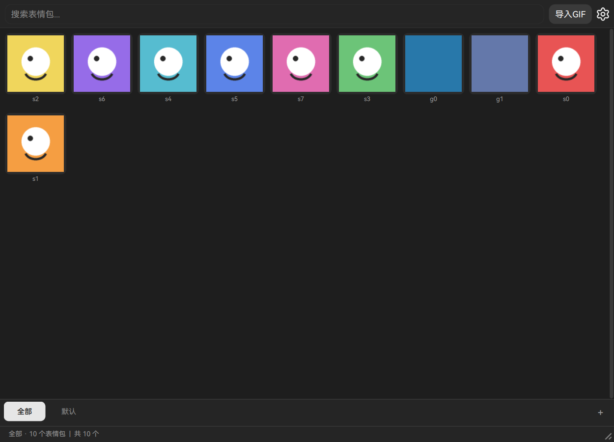

<p align="center"></p>

<h1 align="center">GIFManager</h1>

<p align="center"><b>Your emoji, sticker and GIF library — one keystroke away from any application.</b></p>

<p align="center">
  <a href="README.zh-CN.md">简体中文</a> ·
  <b>English</b>
</p>

<p align="center">
  
  
  
  
  
</p>

<p align="center"></p>

---

GIFManager is a desktop manager for the pictures you send a hundred times a day: reaction GIFs, stickers,
and plain emoji. Instead of scrolling a chat application's sticker panel, you keep your own library on your
own disk, grouped the way you think about it, and retrieve any of it with a single global keystroke — while
the window stays out of the way over whatever you were typing into.

Everything is local. There is no account, no cloud, no network request in the sending path: the library is a
SQLite database next to your files, and "sending" means putting the image — or its file path, whichever your
chat application prefers — on the clipboard.



---

## Contents

- [What it does](#what-it-does)
- [Cross-platform support](#cross-platform-support)
- [Languages](#languages)
- [Project structure](#project-structure)
- [Install](#install)
- [Where your data lives](#where-your-data-lives)
- [Building the installers](#building-the-installers)
- [Development](#development)
- [License and credits](#license-and-credits)

---

## What it does

### A library that stays yours

- **Groups, two kinds.** Image groups hold pictures; text groups hold text snippets. The two never mix, so
  "the right panel" is never ambiguous. Groups can be created, renamed and deleted, and the built-in group
  is protected from deletion.
- **Import from files or a whole folder**, recursively. Anything that is not already a GIF can be converted
  on import, so a folder of PNGs becomes an animated library without a second tool.
- **Search** the current group as you type, and **sort** by import time, name, or how often you actually use
  each sticker — the last one is measured, not guessed: every send increments a counter.
- **Card size from 50% to 200%**, with an optional hover preview and zoom, so the grid can be dense or
  comfortable without changing anything else.

### Sending without leaving the keyboard

- A **global hotkey** summons and hides the window over any application. It accepts a single key (`F10`) or a
  combination (`Ctrl+Alt+F8`); a lone key is deliberately allowed, because a tray utility that demands a
  modifier for its only shortcut is harder to use, not safer.
- Click a sticker and it lands on the **clipboard as image data** (paste anywhere) or **as a file path**
  (which QQ and WeChat accept directly). Which one is a setting.
- **Optional auto-paste**: after the clipboard is filled, GIFManager sends the paste keystroke to the window
  you were in before it appeared, so the whole interaction is *hotkey → click → it is already in the chat*.
- A **tray icon** offers show/hide/quit, and a second launch of the program does not start a second copy — it
  forwards a command (`--toggle`, `--show`, `--hide`, `--quit`) to the running one.

### Editing a library, not one sticker at a time

- **Edit mode** turns the grid into a selection surface: click to toggle, drag to paint the selection across
  cards, *Select all* / *Deselect all* toggles the whole set, then delete or move everything at once.
- **Drag to reorder** cards by hand, or let the frequency sort do it for you.
- **Text stickers** for anything that is a phrase rather than a picture, with separate limits for single-line
  and multi-line content.

### An interface that gets out of the way

- **Dark and light themes**, switched instantly — the palette is applied when you pick it, not after a
  restart or a confirmation dialog.
- A **bundled typeface** (HarmonyOS Sans SC, six weights) so the grid, the labels and the dialogs have the
  same metrics on every machine instead of inheriting whatever the host happens to have installed.
- A deliberately **low-contrast palette** in which the base surfaces sit a few percent apart and only the
  *selected* element is high contrast, so a window opened dozens of times a day stays quiet.
- Frameless window, remember-last-group, restore-window-geometry, always-on-top, start-with-the-system.

### Performance that survives a large library

- GIF frames are **decoded on a worker pool**, never on the thread that draws, and cached under a pixel
  budget. Only the animations **on screen** play; the rest keep a still frame.
- The decode queue is **newest-first with stale work dropped**, so scrolling fast through a thousand
  stickers does not leave the visible row waiting behind rows you already passed.
- An **optional native decoder** (Rust, built from `native/`) makes scrolling smoother still; without it the
  program falls back to a pure-Python path and loses nothing but speed.

---

## Cross-platform support

The application is layered so that all of the logic runs anywhere and only the front-end needs a toolkit. The
table below describes what is actually implemented, honestly labelled:

| Area | Windows | Linux | macOS |
|---|---|---|---|
| Interface (Qt Quick) | ✅ | ✅ | ⚠️ untested |
| Frameless window, rounded corners | ✅ DWM | ✅ | ⚠️ untested |
| Global hotkey | ✅ `RegisterHotKey` | ✅ X11 · ⚠️ Wayland needs the compositor | ❌ not implemented |
| Clipboard send + auto-paste | ✅ `SendInput` | ⚠️ where `xdotool`/`ydotool` exists | ⚠️ untested |
| Tray icon | ✅ | ✅ StatusNotifier | ⚠️ untested |
| Start with the system | ✅ registry | ✅ XDG autostart | ⚠️ untested |
| Single instance + command forwarding | ✅ | ✅ | ⚠️ untested |

**Linux, in more detail.** The build is exercised against a Wayland session (niri). Two things are worth
knowing before you file a bug:

- **Global shortcuts belong to the compositor on Wayland.** The program cannot register one itself, so the
  documented route is a compositor binding that runs `gifmanager --toggle`. Example rules for niri ship as
  `packaging/niri-binds.kdl` and `packaging/niri-window-rule.kdl`.
- The desktop entry must be installed as `gifmanager.desktop` — the XDG portal looks the application up by
  that exact name before it will hand out an app id. `scripts/install-desktop-entry.sh` does it.

**macOS.** The platform backend exists so the layering stays honest, and the interface runs, but it has not
been exercised by CI or by hand. Treat it as unproven rather than supported.

---

## Languages

The interface ships in **English** and **Simplified Chinese**, switchable at runtime from *Settings → General
→ Language* without restarting.

Translations are plain JSON tables under `resources/language/`:

```json
{
  "settings": "Settings",
  "import_gif": "Import GIF"
}
```

To add a language:

1. copy `resources/language/en_US.json` to `<locale>.json` (for example `ja_JP.json`);
2. translate the values — **never the keys**;
3. run `python tools/sync_language_keys.py` — it fails if one table is missing a key another table has, which
   is what keeps a half-translated interface out of a release.

The file name is the locale identifier the settings table offers, so a new file becomes selectable at once.

---

## Project structure

```
gifmanager/
  core/          # store (SQLite), imaging, settings schema, paths, logging   — no toolkit
  platform/      # per-OS services: window, hotkey, clipboard, autostart      — no toolkit
  backend/       # the application object tying core + platform together      — no toolkit
  frontend/
    qml/         # * the shipped interface: Python bridge + 23 .qml files
    qt/          # the earlier QtWidgets shell, kept for comparison
apps/            # entry points: gifmanager_qml.py (shipped), gifmanager_qt.py (legacy)
resources/       # fonts, icons, translations, optional decoder source
packaging/       # PyInstaller specs, Inno Setup script, deb/Arch/AppImage/Flatpak files
tests/           # unit tests and the smoke suite
tools/           # the check suite used by CI and by `make check`
native/          # optional Rust GIF decoder
```

The layering is a rule rather than a suggestion, and CI enforces it with `tools/check_layers.py`:

| Layer | May import | Why the boundary exists |
|---|---|---|
| `core` | standard library | Testable without a display or a toolkit; no `sys.platform` branches. |
| `platform` | `core` | The only place that knows about Windows, macOS or Linux. |
| `backend` | `core`, `platform` | One application object, still toolkit-free. |
| `frontend/*` | everything | The only layer allowed to import PySide6. |

That is also why the QML interface is a new subtree rather than an edit of the old front-end: the backend
already notifies changes, so the declarative interface binds to it instead of rebuilding the grid from twenty
call sites.

---

## Install

### Prebuilt packages

Every release is built manually from `.github/workflows/build.yml` and attached to the release page:

| Platform | File | Notes |
|---|---|---|
| Windows | `GIFManager-Setup-<version>.exe` | Installer (Inno Setup), per-user by default |
| Windows | `GIFManager-<version>-win64.zip` | Portable: unpack and run |
| Debian/Ubuntu | `gifmanager_<version>_amd64.deb` | `sudo apt install ./gifmanager_*.deb` |
| Any Linux | `GIFManager-<version>-linux-x86_64.AppImage` | `chmod +x`, then run |
| Any Linux | `GIFManager-<version>-linux-x86_64.bin` | Self-extracting installer, `--help` for options |
| Arch | `gifmanager-<version>-1-x86_64.pkg.tar.zst` | `sudo pacman -U` |
| Flatpak | `GIFManager-<version>-x86_64.flatpak` | `flatpak install ./GIFManager-*.flatpak` |

### From source

Requires **Python 3.10+** (3.12 recommended). Qt 6.11.1 arrives with PySide6, pinned in `pyproject.toml`.

```bash
git clone https://github.com/LwoSnow/GIFManager.git
cd GIFManager

python -m venv .venv
# Windows: .venv\Scripts\activate
source .venv/bin/activate

pip install -r requirements-dev.txt

python -m gifmanager          # the shipped QML interface
```

Two further entry points reach the same interface: `gifmanager-qml` (console script) and
`apps/gifmanager_qml.py`. `gifmanager` on its own launches the older QtWidgets shell.

An **optional** speed-up for long animated stickers:

```bash
scripts/build-native.sh        # Windows: scripts/build-native.ps1
```

---

## Where your data lives

| What | Where | Override |
|---|---|---|
| Library (SQLite + sticker files) | `~/.local/share/GIFManager` | `GIFMANAGER_DATA_DIR` |
| Logs | `~/.cache/GIFManager/logs` | — |
| Settings | inside the library directory | — |

Nothing leaves the machine. Uninstalling the program does not delete this directory; remove it yourself if
you want a clean start.

---

## Building the installers

The release build is `.github/workflows/build.yml`, triggered **manually** — an installer on every push is
noise that also costs an hour of runner time. It reads the version from `gifmanager/__init__.py`, so a build
can never be labelled with a number the code does not carry, and it produces every file in the table above
from a single bundle build per platform.

Locally:

```bash
make build-qml      # PyInstaller onedir bundle in dist/GIFManager
```

### Uploading the source

This working directory is not a publishable tree: it carries a virtual environment (~680 MB), Rust build
output (~376 MB), PyInstaller output and a few stray test artefacts — about 1.1 GB that should not be pushed.

`make-archive.bat` produces a clean archive instead. It uses `git archive`, so only *tracked* files are
exported, and it drops the handful of tracked files that do not belong in an upload:

```bat
make-archive.bat        :: writes GIFManager-clean.zip beside the script
```

Upload the **contents** of that zip, not the contents of this folder.

---

## Development

```bash
make check          # environment, layering, style, translations, unit tests
make smoke          # the smoke suite (needs a Qt build; runs offscreen)
make run-qml        # run the interface from source
```

The check suite is not decoration — CI runs it before anything is packaged:

| Check | What it refuses |
|---|---|
| `tools/check_layers.py` | a `core` module importing Qt, or front-end logic leaking downwards |
| `tools/check_style.py` | lines over 100 columns, tabs, trailing whitespace, comments that are not bilingual |
| `tools/sync_language_keys.py` | a translation table missing a key another table has |
| `tools/check_batch_encoding.py` | a `.bat` that is not pure ASCII with CRLF endings |
| `tests/smoke_*.py` | a broken import, a blank window, an animation that never advances |

`CONTRIBUTING.md` documents the comment and naming conventions those checks enforce.

---

## License and credits

**MIT** — see [LICENSE](LICENSE). Use it, fork it, ship it.

- **HarmonyOS Sans SC** is bundled under `resources/fonts/` and redistributed under the terms of its own font
  licence.
- The component design follows the ideas in [SWB-QML-UI](https://github.com/xxmzwf/SWB-QML-UI) (MIT) and the
  shadcn aesthetic, ported to QML rather than linked, because PySide6 ships no Qt CMake package.
- The interaction details — press feedback, interruptible motion, contrast-as-state, optical type — come from
  Apple's *Designing Fluid Interfaces* and Emil Kowalski's writing on interface polish.
