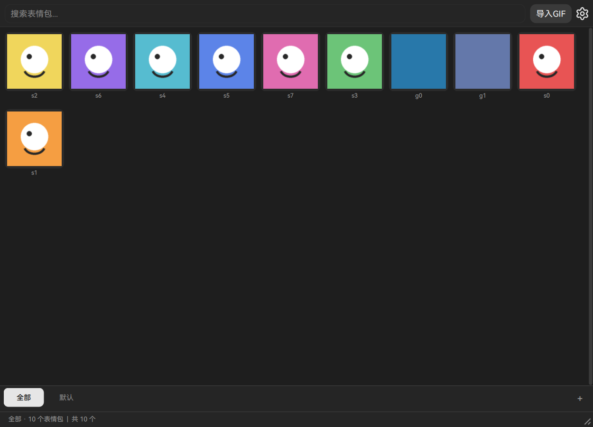

<p align="center"></p>

<h1 align="center">GIFManager</h1>

<p align="center"><b>你的表情包、贴纸与动图库 —— 一个快捷键，直达任何应用。</b></p>

<p align="center">
  <b>简体中文</b> ·
  <a href="README.md">English</a>
</p>

<p align="center">
  
  
  
  
  
</p>

<p align="center"></p>

---

GIFManager 是一个桌面表情包管理器，管的是那些你一天要发上百遍的图：表情动图、贴纸、以及普通 Emoji。
你不必在聊天软件的表情面板里一页页翻找，而是把素材留在自己的硬盘上、按自己的习惯分组，再用**一个全局
快捷键**把它们叫出来 —— 窗口浮在你正在打字的界面之上，不打断手上的事。

所有东西都在本地。没有账号、没有云端、发送链路上没有任何网络请求：素材库就是你文件旁边的一个 SQLite
数据库，而"发送"指的是把图片本身（或它的文件路径，取决于聊天软件更喜欢哪种）放进剪贴板。



---

## 目录

- [它能做什么](#它能做什么)
- [跨平台支持](#跨平台支持)
- [多语言](#多语言)
- [项目结构](#项目结构)
- [安装](#安装)
- [数据存放在哪](#数据存放在哪)
- [构建安装包](#构建安装包)
- [参与开发](#参与开发)
- [许可与致谢](#许可与致谢)

---

## 它能做什么

### 一个始终属于你的素材库

- **两类分组。** 图片分组放图片，文字分组放文字。两者从不混在一起，所以"右边那栏是什么"永远不含糊。
  分组可以新建、重命名、删除，内置分组受保护、不可删除。
- **从文件或整个文件夹导入**，支持递归。不是 GIF 的图片可以在导入时自动转换，于是一个装满 PNG 的
  文件夹会直接变成一个会动的素材库，不需要第二个工具。
- **边打边搜**当前分组，并按导入时间、名称、或**使用频率**排序 —— 最后这个是真统计出来的：每次发送
  都会累加计数，而不是猜的。
- **卡片尺寸 50% 到 200%**，另可选悬停预览与放大，让网格可密可疏，而不牵动其他任何设置。

### 不离开键盘就能发出去

- **全局快捷键**呼出与隐藏窗口，压在任意应用之上。可以是单个按键（`F10`），也可以是组合键
  （`Ctrl+Alt+F8`）—— 刻意允许单键，因为一个只有这一个快捷键的托盘工具还要求按修饰键，只会更难用，
  并不会更安全。
- 点击贴纸，它会以**图片数据**（任何地方都能粘贴）或**文件路径**（QQ、微信可直接粘贴）的形式进入
  **剪贴板**。用哪种是一个设置项。
- **可选自动粘贴**：填充剪贴板后，GIFManager 会把粘贴按键发送回它出现之前你所在的那个窗口，于是整个
  交互变成 *快捷键 → 点一下 → 内容已经在聊天框里*。
- **托盘图标**提供显示/隐藏/退出；再次启动程序不会开出第二个副本，而是把一条命令（`--toggle`、
  `--show`、`--hide`、`--quit`）转交给正在运行的那个。

### 是整理库，不是一张张改

- **编辑模式**把网格变成选择面：点击切换、拖动涂抹连续选中、*全选/取消全选*整批切换，然后一次性删除或
  移动。
- **拖动排序**可以手工摆放，也可以交给频率排序自动决定。
- **文字贴纸**用来放那些"是一句话而不是一张图"的东西，单行与多行各有独立长度上限。

### 一个会主动让路的界面

- **深色与浅色主题**，切换即时生效 —— 选中的那一刻调色板就换好了，不需要重启，也不需要先点确认。
- **随包字体**（HarmonyOS Sans SC，六个字重），让网格、标签与对话框在任何机器上的度量一致，而不是继承
  宿主恰好装了什么字体。
- 刻意的**低对比配色**：基础表面彼此只差几个百分点，只有"选中"才是高对比，于是一个一天开几十次的窗口
  保持安静。
- 无边框窗口、记住上次分组、恢复窗口位置、窗口置顶、开机自启动。

### 撑得住大素材库的性能

- GIF 帧在**工作线程池解码**，绝不在负责绘制的那条线程上，并按像素预算缓存。只有**屏幕上**的动画在播，
  其余的保持一帧静态图。
- 解码队列**最新优先、陈旧任务直接丢弃**，因此在上千张贴纸里快速滚动时，当前可见的那一行不会排在你
  早已滚过的那些行后面干等。
- **可选的原生解码器**（Rust，构建自 `native/`）能让滚动更顺；没有它程序会回退到纯 Python 路径，
  除速度外什么都不损失。

---

## 跨平台支持

程序是分层写的：所有逻辑在任何系统上都能跑，只有前端需要工具包。下表是**实际实现**的情况，如实标注：

| 能力 | Windows | Linux | macOS |
|---|---|---|---|
| 界面（Qt Quick） | ✅ | ✅ | ⚠️ 未测试 |
| 无边框窗口、圆角 | ✅ DWM | ✅ | ⚠️ 未测试 |
| 全局快捷键 | ✅ `RegisterHotKey` | ✅ X11 · ⚠️ Wayland 需交给合成器 | ❌ 未实现 |
| 剪贴板发送 + 自动粘贴 | ✅ `SendInput` | ⚠️ 需要 `xdotool`/`ydotool` | ⚠️ 未测试 |
| 托盘图标 | ✅ | ✅ StatusNotifier | ⚠️ 未测试 |
| 开机自启动 | ✅ 注册表 | ✅ XDG autostart | ⚠️ 未测试 |
| 单实例 + 命令转发 | ✅ | ✅ | ⚠️ 未测试 |

**Linux 的细节。** 本项目在 Wayland 会话（niri）下实测。提 issue 之前，有两点值得先知道：

- **Wayland 下全局快捷键归合成器所有。** 程序无法自己注册，因此文档给出的做法是让合成器绑定一条执行
  `gifmanager --toggle` 的命令。niri 的示例规则随包提供：`packaging/niri-binds.kdl` 与
  `packaging/niri-window-rule.kdl`。
- 桌面条目必须以 `gifmanager.desktop` 这个名字安装 —— XDG 门户会按这个名字查找应用，找到之后才肯发放
  app id。`scripts/install-desktop-entry.sh` 负责这件事。

**macOS。** 平台后端存在，是为了让分层保持诚实，界面也能跑起来，但它既没有经过 CI，也没有经过人工验证。
请当作"未证实"，而不是"已支持"。

---

## 多语言

界面提供**简体中文**与**英文**，可在 *设置 → 通用 → 语言* 里随时切换，无需重启。

翻译就是 `resources/language/` 下的普通 JSON 表：

```json
{
  "settings": "设置",
  "import_gif": "导入 GIF"
}
```

新增一种语言：

1. 把 `resources/language/en_US.json` 复制成 `<区域>.json`（例如 `ja_JP.json`）；
2. 翻译**值**，**绝不改键**；
3. 运行 `python tools/sync_language_keys.py` —— 只要有一张表缺少另一张表已有的键，它就会失败。这条检查
   正是"半翻译的界面进不了发布"的原因。

文件名就是设置里提供的区域标识，所以新增文件立刻可选。

---

## 项目结构

```
gifmanager/
  core/          # 存储（SQLite）、图像、设置 schema、路径、日志   —— 不依赖工具包
  platform/      # 各系统服务：窗口、快捷键、剪贴板、开机启动     —— 不依赖工具包
  backend/       # 把 core 与 platform 串起来的应用对象           —— 不依赖工具包
  frontend/
    qml/         # * 发布用的界面：Python 桥 + 23 个 .qml 文件
    qt/          # 更早的 QtWidgets 外壳，保留作对照
apps/            # 入口：gifmanager_qml.py（发布用）、gifmanager_qt.py（旧）
resources/       # 字体、图标、翻译、可选解码器源码
packaging/       # PyInstaller spec、Inno Setup 脚本、deb/Arch/AppImage/Flatpak 文件
tests/           # 单元测试与冒烟测试
tools/           # CI 与 `make check` 使用的检查套件
native/          # 可选的 Rust GIF 解码器
```

分层是**规则**而不是建议，CI 用 `tools/check_layers.py` 强制它：

| 层 | 可以导入 | 为什么要有这条边界 |
|---|---|---|
| `core` | 标准库 | 无需显示器、无需工具包即可测试；不出现 `sys.platform` 分支。 |
| `platform` | `core` | 唯一知道 Windows / macOS / Linux 差异的地方。 |
| `backend` | `core`、`platform` | 一个应用对象，仍然不依赖工具包。 |
| `frontend/*` | 任意 | 唯一允许导入 PySide6 的层。 |

这也解释了为什么 QML 界面是一棵新子树、而不是在旧前端上改动：后端本来就会发出变更通知，因此声明式前端
直接绑定它，而不必从二十个调用点分别重建网格。

---

## 安装

### 预构建包

每次发布都由 `.github/workflows/build.yml` **手动**构建，产物挂在 Release 页面：

| 平台 | 文件 | 说明 |
|---|---|---|
| Windows | `GIFManager-Setup-<版本>.exe` | 安装器（Inno Setup），默认按用户安装 |
| Windows | `GIFManager-<版本>-win64.zip` | 便携版：解压即用 |
| Debian/Ubuntu | `gifmanager_<版本>_amd64.deb` | `sudo apt install ./gifmanager_*.deb` |
| 任意 Linux | `GIFManager-<版本>-linux-x86_64.AppImage` | `chmod +x` 后直接运行 |
| 任意 Linux | `GIFManager-<版本>-linux-x86_64.bin` | 自解压安装器，`--help` 查看选项 |
| Arch | `gifmanager-<版本>-1-x86_64.pkg.tar.zst` | `sudo pacman -U` |
| Flatpak | `GIFManager-<版本>-x86_64.flatpak` | `flatpak install ./GIFManager-*.flatpak` |

### 从源码运行

需要 **Python 3.10+**（建议 3.12）。Qt 6.11.1 随 PySide6 一起安装，版本在 `pyproject.toml` 中锁定。

```bash
git clone https://github.com/LwoSnow/GIFManager.git
cd GIFManager

python -m venv .venv
# Windows：.venv\Scripts\activate
source .venv/bin/activate

pip install -r requirements-dev.txt

python -m gifmanager          # 发布用的 QML 界面
```

另外两种入口到达同一个界面：`gifmanager-qml`（控制台脚本）与 `apps/gifmanager_qml.py`。单独运行
`gifmanager` 启动的是较早的 QtWidgets 外壳。

可选的速度提升（针对很长的动图）：

```bash
scripts/build-native.sh        # Windows：scripts/build-native.ps1
```

---

## 数据存放在哪

| 内容 | 位置 | 覆盖方式 |
|---|---|---|
| 素材库（SQLite + 贴纸文件） | `~/.local/share/GIFManager` | 环境变量 `GIFMANAGER_DATA_DIR` |
| 日志 | `~/.cache/GIFManager/logs` | — |
| 设置 | 素材库目录内 | — |

没有任何数据离开这台机器。卸载程序**不会**删除这个目录；想要干净重来请自行删除。

---

## 构建安装包

发布构建是 `.github/workflows/build.yml`，**手动触发** —— 每次推送都产出一个安装包既是噪音，也要为每轮
花掉近一小时的运行时间。它从 `gifmanager/__init__.py` 读取版本号，因此构建产物永远不会被标上一个代码
并未携带的版本号；每个平台只构建一次包，再由它产出上表里的全部格式。

本地：

```bash
make build-qml      # 在 dist/GIFManager 生成 PyInstaller onedir 包
```

### 上传源码

当前工作目录**不是**一个可以直接发布的目录：它带着虚拟环境（约 680 MB）、Rust 构建产物（约 376 MB）、
PyInstaller 输出，以及几个测试留下的杂项 —— 约 1.1 GB 不该被推送的东西。

`make-archive.bat` 用来生成干净的归档。它调用 `git archive`，因此只导出**被跟踪**的文件，并额外剔除那几个
被跟踪、但不该出现在上传里的文件：

```bat
make-archive.bat        :: 在脚本同级生成 GIFManager-clean.zip
```

上传的是那个 zip 的**内容**，不是这个文件夹的内容。

---

## 参与开发

```bash
make check          # 环境、分层、风格、翻译、单元测试
make smoke          # 冒烟测试（需要 Qt 构建；以离屏方式运行）
make run-qml        # 从源码运行界面
```

检查套件不是装饰 —— CI 在打包任何东西之前都先跑它：

| 检查 | 它拒绝什么 |
|---|---|
| `tools/check_layers.py` | `core` 导入 Qt，或前端逻辑向下泄漏 |
| `tools/check_style.py` | 超过 100 列的行、制表符、行尾空白、非双语的注释 |
| `tools/sync_language_keys.py` | 某张翻译表缺少另一张表已有的键 |
| `tools/check_batch_encoding.py` | 不是纯 ASCII + CRLF 的 `.bat` |
| `tests/smoke_*.py` | 坏掉的导入、空窗口、永不推进的动画 |

`CONTRIBUTING.md` 记录了上述检查所强制的注释与命名约定。

---

## 许可与致谢

**MIT** —— 见 [LICENSE](LICENSE)。可以随意使用、fork、发布。

- **HarmonyOS Sans SC** 随包放在 `resources/fonts/`，按其字体自身的许可条款再分发。
- 组件设计参考 [SWB-QML-UI](https://github.com/xxmzwf/SWB-QML-UI)（MIT）与 shadcn 的审美，采用**移植**
  而非链接的方式，因为 PySide6 不自带 Qt 的 CMake 包。
- 交互细节 —— 按下即反馈、可中断的运动、以对比表达状态、光学的排版 —— 来自 Apple 的
  *Designing Fluid Interfaces* 与 Emil Kowalski 关于界面打磨的写作。
